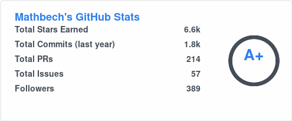
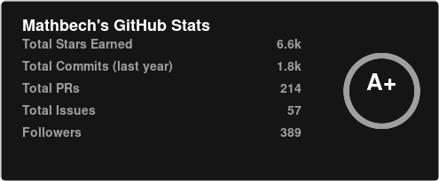
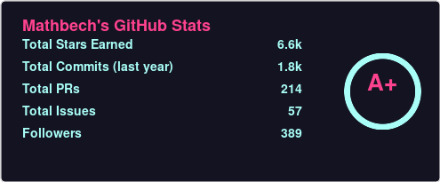
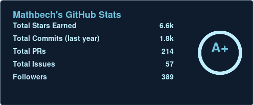
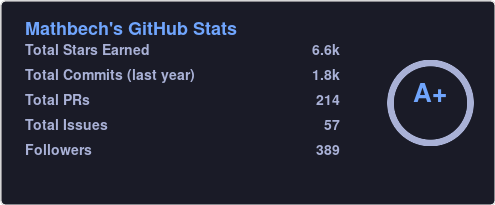
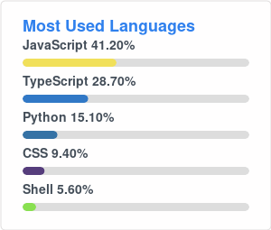
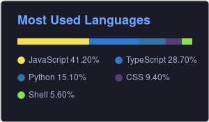
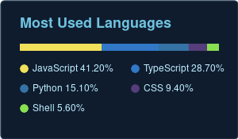

# my-git-stats

Ton propre service de cartes de stats GitHub en SVG, écrit de zéro — **aucun fork**. Node + Express interrogent l'API GraphQL de GitHub et génèrent les images. L'API reproduit les URLs de github-readme-stats, donc tu remplaces juste `...vercel.app` par ton domaine dans tes READMEs.

```
Navigateur → (CloudFront plus tard) → Apache HTTPS → Node/Express (127.0.0.1:9000) → API GitHub
```

Instance en ligne : `https://my-git-stats.bebech.fr`

## Galerie & URLs

Aperçus générés avec des données factices (`node scripts/gen-previews.js`).

### Carte de stats — `/api`

| Thème | Aperçu | URL |
| --- | --- | --- |
| `default` |  | `https://my-git-stats.bebech.fr/api?username=Mathbech` |
| `dark` |  | `https://my-git-stats.bebech.fr/api?username=Mathbech&theme=dark` |
| `radical` |  | `https://my-git-stats.bebech.fr/api?username=Mathbech&theme=radical` |
| `ocean_dark` |  | `https://my-git-stats.bebech.fr/api?username=Mathbech&theme=ocean_dark` |
| `tokyonight` |  | `https://my-git-stats.bebech.fr/api?username=Mathbech&theme=tokyonight` |

### Top langages — `/api/top-langs`

| Layout / thème | Aperçu | URL |
| --- | --- | --- |
| `normal` / `default` |  | `https://my-git-stats.bebech.fr/api/top-langs?username=Mathbech` |
| `compact` / `tokyonight` |  | `https://my-git-stats.bebech.fr/api/top-langs?username=Mathbech&layout=compact&theme=tokyonight` |
| `compact` / `ocean_dark` |  | `https://my-git-stats.bebech.fr/api/top-langs?username=Mathbech&layout=compact&theme=ocean_dark` |

### Paramètres d'URL

Communs : `theme`, `title_color`, `text_color`, `icon_color`, `bg_color`, `border_color`, `hide_border`, `custom_title`, `card_width`.
Stats : `show_icons`, `include_all_commits`, `hide_rank`, `ring_color`.
Top langs : `layout` (`normal`\|`compact`), `langs_count` (1–20).

Thèmes fournis : `default`, `dark`, `radical`, `ocean_dark`, `tokyonight`. Ajoute les tiens dans `src/themes.js`.

Le **rang** (cercle S / A+ / A … C) est un score calculé par le service (`src/rank.js`, même formule que github-readme-stats : somme pondérée de percentiles sur commits, PRs, issues, reviews, stars, followers). Ce n'est **pas** une métrique officielle GitHub. Masque-le avec `hide_rank=true`.

Les commits affichés couvrent les **12 derniers mois** (fenêtre glissante de l'API GitHub) ; stars, PRs, issues et followers sont des cumuls.

## Configuration : `.env` vs `.env.local`

Deux fichiers, une règle simple :

- **`.env`** — versionné (committé). Uniquement des valeurs **non-sensibles** (`CACHE_SECONDS`, `WHITELIST`). `PAT_1` y reste **vide**.
- **`.env.local`** — **ignoré par git**. C'est ici que tu mets ton vrai token. Il a la priorité sur `.env`.

`.env.local` :

```env
PAT_1=ghp_ton_vrai_token
```

Le token se crée sur https://github.com/settings/tokens → *Generate new token (classic)* → scopes **`repo`** + **`read:user`**.

> Priorité de chargement : variables du shell/systemd > `.env.local` > `.env`.

## Démarrer en local

```bash
npm install
# mets ton token dans .env.local
npm start                 # http://localhost:9000/api?username=Mathbech
```

Test du rendu sans token (données factices) : `npm run smoke`.
Régénérer la galerie : `node scripts/gen-previews.js`.

## Déploiement sur le VPS (sans Docker)

```bash
# Copie le projet, crée .env.local avec le token, puis :
npm install --omit=dev
node server.js            # écoute sur 127.0.0.1:9000
```

Garde le process en vie avec ce que tu préfères (systemd, pm2…) et place un reverse proxy HTTPS devant (Apache/Nginx/Caddy) qui relaie vers `127.0.0.1:9000`. Le port 9000 n'est jamais exposé directement au public.

## Gestion des erreurs

En cas d'erreur (token manquant, panne de l'API GitHub…), la page renvoie un **HTTP 500** avec un SVG vide et `Cache-Control: no-store` — aucun détail technique exposé (donc rien de lisible sur GitHub). Le détail complet part dans les logs : `logs/error.log` (dans le projet) **et** la console (`journalctl -u <service>`).

## Instance publique (partage entre potes)

Renseigne les usernames autorisés dans `WHITELIST` (fichier `.env`) pour protéger ton quota d'API GitHub (5000 req/h partagés sur ton token) :

```env
WHITELIST=Mathbech,pote1,pote2
```

Aucune fuite de données privées pour les autres : ton token ne voit que **tes** repos privés ; pour un autre username, GitHub ne renvoie que ses données publiques.

## Structure

```
server.js              → serveur Express, routes, cache, whitelist
src/loadenv.js         → charge .env / .env.local
src/github.js          → requêtes GraphQL + agrégation
src/cards/*.js         → rendu SVG des cartes
src/rank.js            → calcul du rang (S / A+ / ... / C)
src/themes.js          → palette de thèmes
src/utils.js           → helpers
src/logger.js          → journalisation des erreurs (fichier + console)
scripts/smoke.js       → test de rendu hors-ligne
scripts/gen-previews.js→ génère la galerie assets/
assets/                → aperçus du README
```

## Idées d'évolution

Cartes `pin` / `gist` / `wakatime`, pagination au-delà de 100 repos, cache Redis, rotation multi-tokens (`PAT_1..PAT_n`). La structure `src/cards/*` + route dans `server.js` est faite pour s'étendre.
